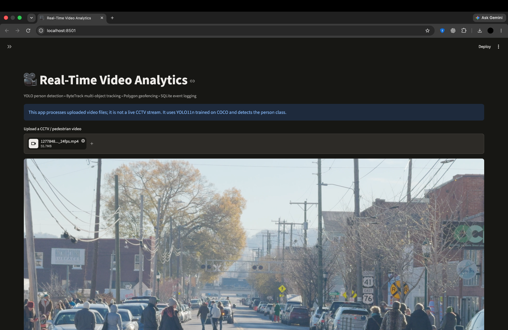
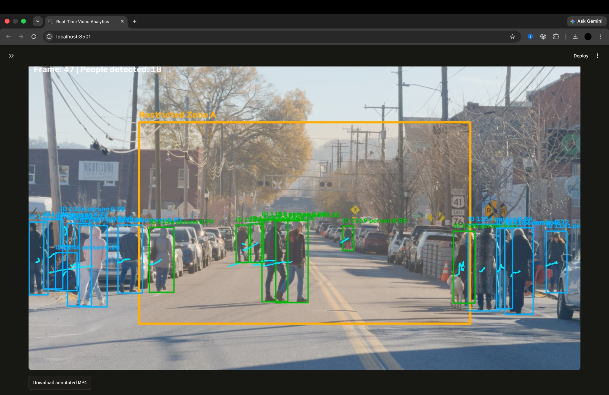
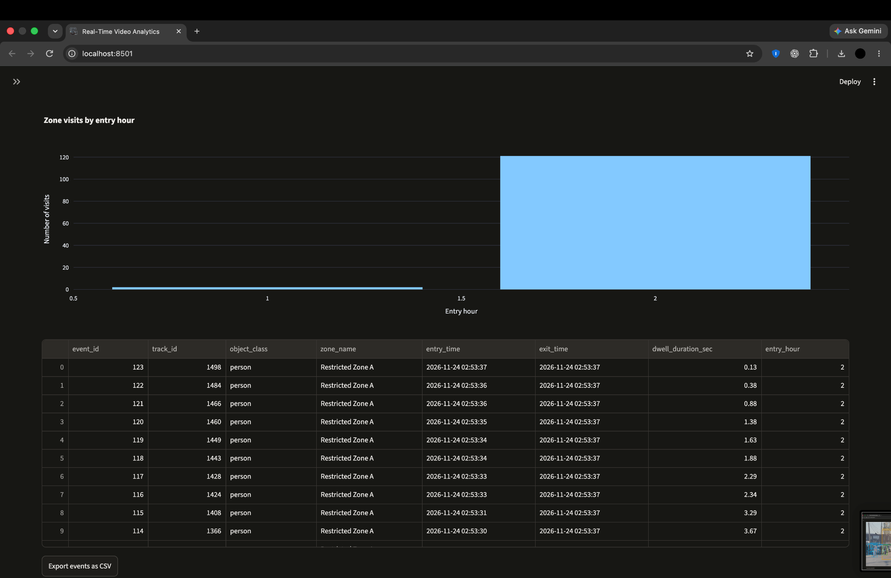
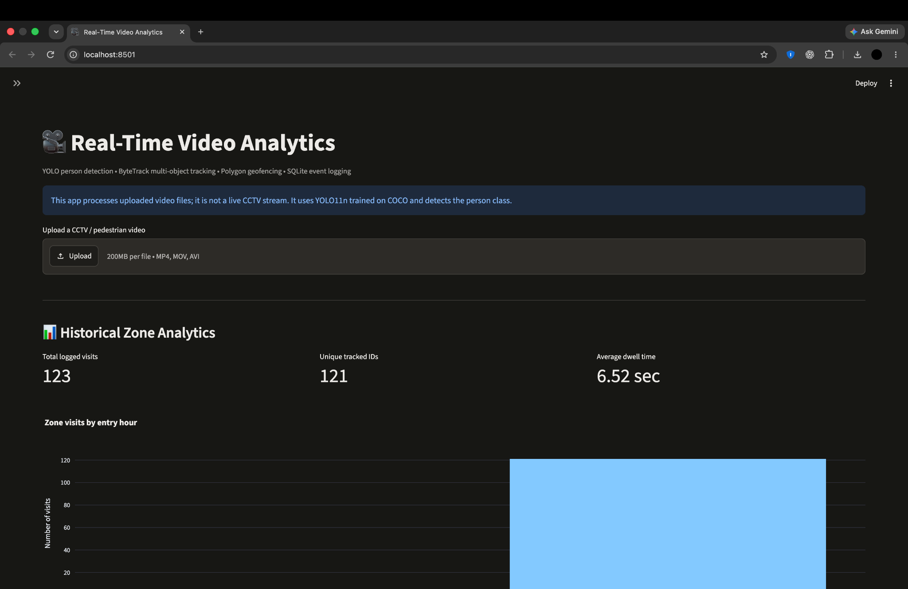

# Real-Time Video Analytics

A Python-based video analytics application that processes uploaded CCTV
or pedestrian video files to detect and track people, monitor activity
inside a user-defined restricted zone, and generate historical visit
analytics.

> **Project scope:** This application processes uploaded video files. It
> is not connected to a live CCTV camera or live streaming feed.

## Overview

The application uses **YOLO11n**, trained on the COCO dataset, to detect
people in video frames. **ByteTrack** assigns tracking IDs so that
detected people can be followed across sampled frames. A polygonal
restricted zone is used to identify zone-entry activity. Visit events
are stored in a local SQLite database and displayed in the Streamlit
dashboard.

## Features

-   **Video upload:** Upload supported video files (`MP4`, `MOV`, or
    `AVI`).
-   **Person detection:** Detect people in sampled video frames using
    YOLO11n.
-   **Multi-object tracking:** Use ByteTrack to maintain tracking IDs
    across frames.
-   **Polygon geofencing:** Define and monitor a restricted zone within
    the video.
-   **Zone event logging:** Record zone visits, entry and exit
    timestamps, tracked IDs, and dwell duration.
-   **Historical analytics:** View total logged visits, unique tracked
    IDs, average dwell time, and visits by entry hour.
-   **Annotated output:** Review the processed video with detection
    boxes, tracking IDs, and the restricted-zone overlay.
-   **CSV export:** Export the logged zone events for further analysis.

## Application Screenshots

### 1. Application and video upload

The dashboard provides the video upload interface and a historical
analytics overview.



### 2. Person detection, tracking, and restricted zone

Detected people are marked with bounding boxes and tracking IDs. The
polygon overlay indicates the monitored restricted zone.


### 3. Historical zone analytics

The dashboard summarizes logged visits, unique tracked IDs, average
dwell time, and visit distribution by entry hour.



### 4. Zone visits and event records

The chart and event table provide a view of recorded zone activity.



### 5. Event table and CSV export

Review individual event records and export them as a CSV file.



## Technology Stack

  Technology            Purpose
  --------------------- -------------------------------------------------
  Python                Core application logic
  Streamlit             Interactive web interface
  Ultralytics YOLO11n   Person detection
  ByteTrack             Multi-object tracking
  OpenCV                Video frame reading, processing, and annotation
  SQLite                Local storage for zone-event records
  Plotly                Analytics visualizations
  Pandas                Tabular event data and CSV export

## How It Works

1.  The user uploads a CCTV or pedestrian video.
2.  The application reads the video and samples frames for processing.
3.  YOLO11n detects people in each processed frame.
4.  ByteTrack associates detections across frames and assigns tracking
    IDs.
5.  The application checks tracked people against the configured
    polygonal restricted zone.
6.  Zone visits and related timestamps are recorded in SQLite.
7.  The dashboard displays the annotated video, event records, and
    historical analytics.
8.  The user can export the event data as a CSV file.

## Project Structure

``` text
assignment3-real-time-video-analytics/
├── app.py
├── requirements.txt
├── README.md
├── .gitignore
├── data/
├── models/
│   ├── best.pt                  # Optional/local model weights, if used
│   └── PUT_MODEL_HERE.txt
├── output/
│   └── .gitkeep
└── screenshots/
    ├── 01-app-upload.png
    ├── 02-detection-tracking-zone.png
    ├── 03-historical-analytics.png
    ├── 04-zone-visits-events.png
    └── 05-event-table-export.png
```

The exact contents of `data/`, `models/`, and `output/` may vary
depending on local setup and generated files. Model weights, datasets,
virtual environments, and generated videos should remain local unless
there is a specific reason to publish them.

## Setup and Installation

### 1. Clone the repository

``` bash
git clone https://github.com/yashanki1317/assignment3-real-time-video-analytics.git
cd assignment3-real-time-video-analytics
```

### 2. Create and activate a virtual environment

**macOS / Linux**

``` bash
python3 -m venv .venv
source .venv/bin/activate
```

**Windows**

``` bash
python -m venv .venv
.venv\Scripts\activate
```

### 3. Install dependencies

``` bash
python -m pip install --upgrade pip
pip install -r requirements.txt
```

### 4. Add required model weights

Place the model weights expected by the application in the `models/`
directory. Keep large `.pt` files out of Git unless the repository is
intentionally configured to distribute them.

### 5. Run the application

``` bash
streamlit run app.py
```

Open the local URL printed by Streamlit in your browser (usually
`http://localhost:8501`).

## Usage

1.  Start the Streamlit application.
2.  Upload an MP4, MOV, or AVI video.
3.  Review the video preview and configured restricted zone.
4.  Run video processing.
5.  Inspect the annotated frames/video and processing summary.
6.  Review historical zone analytics and event records.
7.  Select **Export events as CSV** to download the event data.

## Notes and Limitations

-   The current application analyzes uploaded video files; it does not
    ingest a live CCTV stream.
-   The model shown in the application is the general-purpose YOLO11n
    COCO model and detects the `person` class.
-   Detection and tracking quality can vary with camera angle,
    resolution, lighting, occlusion, and object size.
-   A visit still active at the end of a clip may be closed at the clip
    end for reporting.
-   SQLite event data is stored locally; it is not automatically
    synchronized to a remote database.

## Future Improvements

-   Add live camera or RTSP stream support.
-   Support multiple configurable zones.
-   Add alerting for restricted-zone activity.
-   Add filters by date, zone, and tracked ID.
-   Add persistent remote database storage and deployment configuration.

## Author

**Yashanki Dhupia**

GitHub: [@yashanki1317](https://github.com/yashanki1317)
